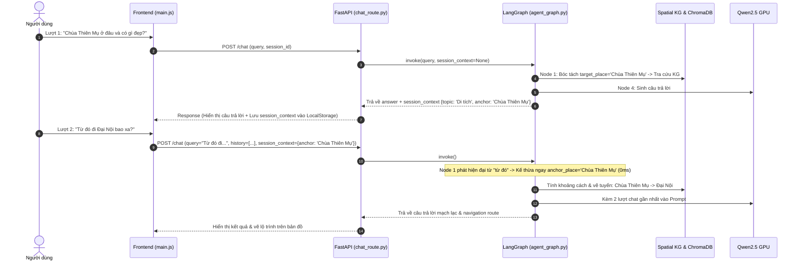

# Kế hoạch Triển khai: Quản lý Chủ đề & Trí nhớ Ngữ cảnh Phiên chat (Session Topic & Contextual Memory)

> **Mục tiêu:** Cung cấp cho trợ lý ảo khả năng ghi nhớ ngữ cảnh hội thoại đa lượt (Multi-turn Conversation), tự động nhận diện và duy trì **Chủ đề phiên (Session Topic)**, và giải quyết triệt để vấn đề đồng tham chiếu (Anaphora: *"ở đó"*, *"chỗ này"*, *"từ đó đi..."*) với độ trễ tối ưu nhất (Zero LLM Overhead).

---

## 1. Phân tích Hiện trạng & Điểm nghẽn (Analysis)

| Thành phần | Hiện trạng | Vấn đề / Điểm nghẽn |
| :--- | :--- | :--- |
| **Frontend** (`main.js`, `api.js`) | Có `activeSessionId`, `activeSessionMessages` nhưng chỉ gửi câu hỏi đơn lẻ | Backend nhận request hoàn toàn tách rời, không biết câu trước hỏi gì |
| **API Schema** (`chat_schema.py`) | `ChatRequest` chỉ có `query`, `user_lat`, `user_lng`, `preferences`, `image_base64` | Thiếu `session_id`, `history`, `session_context` |
| **Agent State** (`agent_graph.py`) | `TourismAgentState` là stateless; Node 1 bóc tách thực thể chỉ nhìn vào câu hỏi hiện tại | Khi hỏi *"Ở đó có gì?"*, KG không tìm thấy thực thể $\rightarrow$ RAG gãy |
| **LLM Generation** (`agent_graph.py`) | Prompt gửi tới Qwen2.5 chỉ gồm context vừa tìm + 1 câu hỏi | Trả lời rời rạc, có thể lặp lại lời chào/thông tin cũ |

---

## 2. Kiến trúc Giải pháp (Solution Architecture)

### 2.1 Cấu trúc Dữ liệu `SessionContext` (Zero Overhead)
```json
{
  "session_id": "session_1741165890",
  "topic_name": "Di tích & Lịch sử Cố đô",
  "topic_domain": "heritage",
  "anchor_place": "Chùa Thiên Mụ",
  "anchor_dish": null,
  "turn_count": 2,
  "updated_at": "2026-11-05T10:00:00Z"
}
```

### 2.2 Luồng xử lý Đa lượt (Multi-turn Flow)


---

## 3. Kế hoạch Thực hiện Chi tiết (Action Items)

### Giai đoạn 1: Nâng cấp Schemas & Định tuyến Backend (API Contract)
- [x] **Task 1.1: Cập nhật `src/app/schemas/chat_schema.py`**
  - Mở rộng `ChatRequest`: thêm `session_id: Optional[str]`, `history: Optional[List[Dict[str, str]]] = None`, `session_context: Optional[Dict[str, Any]] = None`.
  - Mở rộng `ChatResponse`: thêm `session_context: Optional[Dict[str, Any]] = None`.
- [x] **Task 1.2: Cập nhật `src/app/routes/chat_route.py`**
  - Nhận và truyền `session_id`, `history`, `session_context` vào `initial_state` của LangGraph.
  - Trích xuất `res.get("session_context")` và trả về trong `ChatResponse`.

### Giai đoạn 2: Tích hợp Trí nhớ & Nhận diện Chủ đề trong LangGraph
- [x] **Task 2.1: Cập nhật `TourismAgentState` trong `src/rag/agent_graph.py`**
  - Khai báo các trường: `session_id`, `history`, `session_context`.
- [x] **Task 2.2: Tích hợp Bộ suy luận Đồng tham chiếu (Anaphora Resolver) tại Node 1**
  - Thêm bộ quy tắc phát hiện đại từ chỉ định tiếng Việt (*"ở đó", "quanh đó", "gần đây", "chỗ này", "quán đó", "từ đó đi...", "từ đây qua..."*).
  - Tự động gán `target_place = anchor_place` hoặc `target_dish = anchor_dish` nếu người dùng không nhắc tên mới.
- [x] **Task 2.3: Tự động phân loại và cập nhật `SessionContext`**
  - Xác định miền chủ đề (`heritage`, `culinary`, `leisure`, `route_navigation`) dựa trên thực thể được truy xuất.
  - Cập nhật địa danh mốc mới nhất làm `anchor_place`.
- [x] **Task 2.4: Đưa Lịch sử Hội thoại vào Prompt Node 4 (`node_generate_response`)**
  - Chèn 2-3 lượt trao đổi gần nhất vào System/Human Message để câu trả lời có tính kế thừa tự nhiên.

### Giai đoạn 3: Tích hợp Phía Giao diện Người dùng (Frontend)
- [x] **Task 3.1: Nâng cấp `frontend/src/api.js`**
  - `TourismApiClient.askAssistant`: gửi kèm `sessionId`, `history` (cắt lát 4 tin nhắn gần nhất), `sessionContext`.
- [x] **Task 3.2: Nâng cấp `frontend/src/main.js`**
  - Trong `sendChatQuery`: chuẩn bị payload từ `activeSessionMessages`.
  - Lưu `res.session_context` vào session hiện tại.
- [x] **Task 3.3: ~~Topic Badge~~ → bước XAI "🔗 Kế thừa ngữ cảnh hội thoại" trong graph trace** (header mobile bị ẩn nên badge không hiển thị được)
  - Hiển thị chip chủ đề nhỏ ở thanh tiêu đề chat (ví dụ: `🏷️ Chủ đề: Di tích Cố đô · Chùa Thiên Mụ`).

### Giai đoạn 4: Kiểm thử & Đánh giá (Verification & Testing)
- [x] **Task 4.1: Viết kịch bản kiểm thử đa lượt `tests/test_session_memory.py`**
  - Case 1: Lượt 1 hỏi về *Chùa Thiên Mụ*, Lượt 2 hỏi *"Từ đó đi Đại Nội bao xa?"* $\rightarrow$ Xác nhận hệ thống tự nhận diện gốc = Chùa Thiên Mụ, đích = Đại Nội.
  - Case 2: Lượt 1 hỏi về *Bún bò mụ Rơi*, Lượt 2 hỏi *"Quán này mở cửa mấy giờ?"* $\rightarrow$ Xác nhận hệ thống trả lời giờ mở cửa của Bún bò mụ Rơi.
  - Case 3: Chuyển đổi chủ đề (Topic Drift): Lượt 1 hỏi di tích, Lượt 2 hỏi quán ăn $\rightarrow$ Xác nhận chủ đề cập nhật từ `heritage` sang `culinary`.
- [x] **Task 4.2: Build frontend check**
  - Chạy `npm run build` xác nhận không có lỗi syntax/bundle.

---

## 4. Các Trường hợp Biên & Rủi ro (Edge Cases & Trade-offs)

1. **Người dùng đổi chủ đề đột ngột (Topic Drift):**  
   *Xử lý:* Nếu câu hỏi mới nhắc tới một thực thể cụ thể mới (ví dụ đang nói Chùa Thiên Mụ bỗng hỏi *"Giá vé Lăng Khải Định"*), hệ thống ghi đè ngay `anchor_place = "Lăng Khải Định"` mà không bị kẹt ở chủ đề cũ.
2. **Session quá dài (Context Window Bloat):**  
   *Xử lý:* Frontend chỉ trích xuất tối đa 4 tin nhắn gần nhất để gửi lên Backend, giữ token đầu vào luôn dưới 500 tokens, đảm bảo thời gian sinh câu trả lời siêu nhanh.
3. **Mất kết nối hoặc Colab khởi động lại:**  
   *Xử lý:* Toàn bộ `session_context` được lưu ở LocalStorage của trình duyệt, nên dù server Colab có restart thì phiên chat tiếp theo vẫn gửi lại context cũ, không bị mất trí nhớ.


---

## 5. Ghi chú triển khai (khác so với kế hoạch gốc)
- Không dùng LocalStorage: `session_context` nằm trong `resData` của tin nhắn trợ lý đã lưu Firestore → mở lại phiên cũ vẫn nhớ, đổi thiết bị vẫn nhớ.
- Giải đồng tham chiếu bằng cách **viết lại câu hỏi** (`src/rag/session_memory.py::resolve_anaphora`) trước khi bóc tách alias → luồng chỉ đường A → B và heuristic ở `chat_route.py` dùng chung câu đã giải nghĩa.
- Anchor lưu theo `node_id`, server kiểm tra lại với KG mỗi lượt và tự lấy nhãn từ KG (không tin nhãn client gửi).
- Ưu tiên anchor: điểm đến chỉ đường > địa danh trong ảnh > địa danh được hỏi > quán đầu tiên khi hỏi món.
- Case 2 dùng **Bún Bò Mụ Kéo** (`custom_local_26`) vì KG không có "Bún bò Mụ Rơi".
